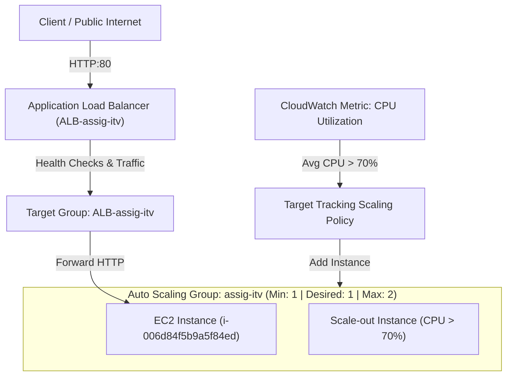
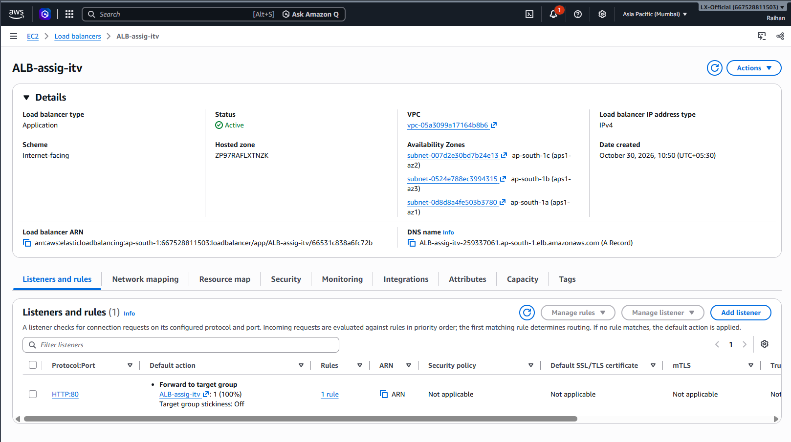
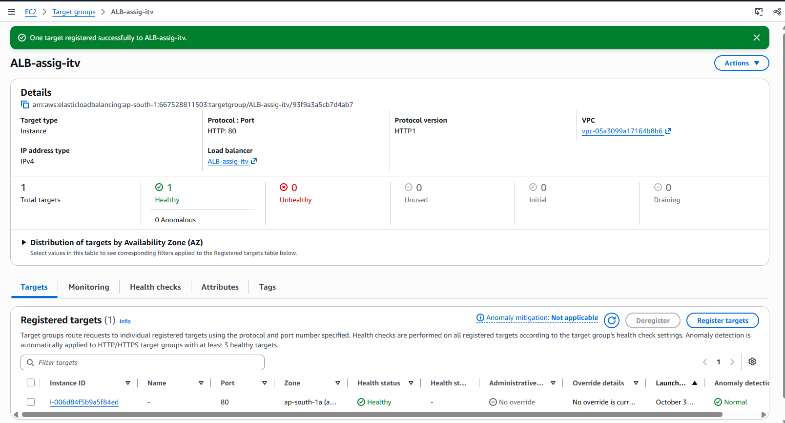
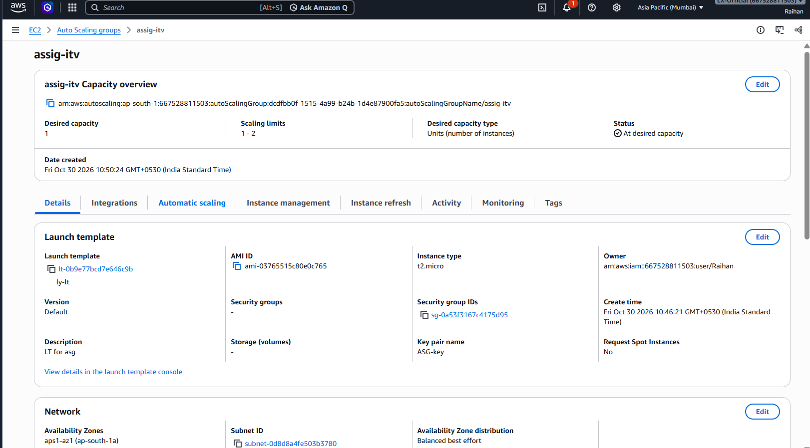
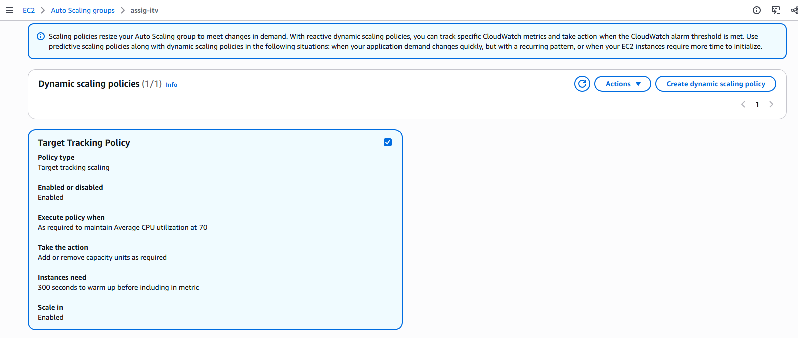
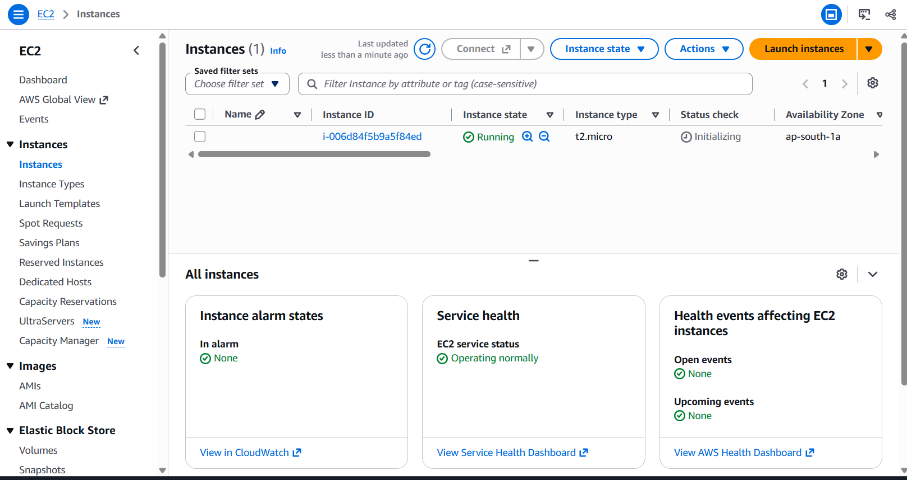

# Assignment 3: High Availability Auto Scaling Group (ASG) & Application Load Balancer (ALB)

## 📌 Overview
This assignment demonstrates designing and deploying a resilient, self-healing, and elastic compute tier on AWS. Traffic is received and distributed by an **Application Load Balancer (ALB)** across EC2 instances managed by an **Auto Scaling Group (ASG)**. The architecture includes automated target tracking scaling when CPU utilization exceeds 70%, combined with automatic detection and replacement of unhealthy instances.

---

## ⚙️ Environment & AWS Configuration
* **AWS Profile:** `lxof`
* **AWS Account ID:** `667528811503`
* **AWS Region:** `ap-south-1` (Mumbai)
* **VPC ID:** `vpc-05a3099a17164b8b6`
* **Launch Template:** `ly-lt` (`lt-0b9e77bcd7e646c9b`)
* **Auto Scaling Group:** `assig-itv`
* **Application Load Balancer:** `ALB-assig-itv`
* **Target Group:** `ALB-assig-itv`

---

## 🏗️ Architecture & High Availability Flow



---

## 📁 Repository Structure
```text
ASG+ALB/
├── ALB.png                 # Application Load Balancer details, listeners, and DNS configuration
├── ASG.png                 # Auto Scaling Group capacity, launch template, and network settings
├── Dynamic-scale.png       # Target tracking policy configured for CPU > 70%
├── Target.png              # Target Group configuration showing healthy registered EC2 target
├── instance.png            # Active EC2 instance running in ap-south-1a
└── README.md               # Assignment documentation and runbook
```

---

## 🛠️ Step-by-Step Implementation & Configuration

### 1. Launch Template (`ly-lt`)
* **Template ID:** `lt-0b9e77bcd7e646c9b`
* **AMI:** `ami-03765515c80e0c765` (Amazon Linux)
* **Instance Type:** `t2.micro`
* **Key Pair:** `ASG-key`
* **Security Group:** `sg-0a53f3167c4175d95` (allows HTTP 80 from ALB and administrative SSH access)
* Standardizes instance bootstrap, configurations, and application runtime for newly scaled instances.

### 2. Application Load Balancer (`ALB-assig-itv`)
* **Scheme:** Internet-facing (IPv4)
* **VPC:** `vpc-05a3099a17164b8b6`
* **Multi-AZ Availability:** Configured across three availability zones for fault tolerance:
  * `ap-south-1a` (`subnet-0d8d8a4fe503b3780`)
  * `ap-south-1b` (`subnet-0524e788ec3994315`)
  * `ap-south-1c` (`subnet-007d2e30bd7b24e13`)
* **DNS Name:** `ALB-assig-itv-259337061.ap-south-1.elb.amazonaws.com`
* **Listener:** HTTP on port 80 forwarding 100% of incoming traffic to Target Group `ALB-assig-itv`.

### 3. Target Group (`ALB-assig-itv`)
* **Target Type:** Instance
* **Protocol & Port:** `HTTP:80`
* **Health Check Path:** `/`
* **Target Status:** 1 target registered (`i-006d84f5b9a5f84ed`), status verified as **Healthy**.

### 4. Auto Scaling Group (`assig-itv`)
* **Launch Template Reference:** `ly-lt` (Default Version)
* **Capacity Limits:**
  * **Desired Capacity:** 1
  * **Minimum Capacity:** 1
  * **Maximum Capacity:** 2
* **Network / Subnet:** `subnet-0d8d8a4fe503b3780` in `ap-south-1a`
* Integrated with Target Group `ALB-assig-itv` to automatically register newly launched instances.

### 5. Dynamic Scaling Policy (Target Tracking at 70% CPU)
* **Policy Name:** Target Tracking Policy
* **Policy Type:** Target Tracking Scaling
* **Target Metric:** Average CPU Utilization maintained at **70%**
* **Warm-up Period:** 300 seconds (allows instance initialization before factoring into metrics)
* **Scale-In:** Enabled (automatically decrements capacity when CPU returns to nominal levels)
* **Behavior:** When application load increases and average CPU utilization crosses 70%, CloudWatch alarms trigger the ASG to scale out by launching an additional EC2 instance up to the maximum limit of 2.

### 6. Automatic Replacement of Unhealthy Instances (Self-Healing)
* **Health Check Integration:** ASG leverages both EC2 instance status checks and ALB target group health check signals.
* **Failure Detection:** If an instance crashes, stops responding on port 80, or fails consecutive health check thresholds, the Target Group marks the instance status as `Unhealthy`.
* **Automated Remediation:**
  1. The ASG detects the unhealthy status reported by ELB/EC2.
  2. The ASG marks the degraded instance for termination.
  3. The ASG drains traffic, terminates the unhealthy instance, and immediately provisions a fresh EC2 instance from Launch Template `ly-lt`.
  4. The newly created instance initializes, passes Target Group health checks, and is brought back into active rotation, maintaining the desired capacity of 1 without manual intervention.

---

## 📷 Verification Screenshots

### 1. Application Load Balancer (ALB)
Displays the internet-facing load balancer, DNS endpoint, multi-AZ subnets, and HTTP:80 forwarding rule:


---

### 2. Target Group & Health Status
Displays Target Group `ALB-assig-itv` with instance `i-006d84f5b9a5f84ed` reporting healthy status:


---

### 3. Auto Scaling Group Configuration
Displays capacity limits (Min: 1, Max: 2, Desired: 1), Launch Template `ly-lt`, and network mapping:


---

### 4. Dynamic Scaling Policy (CPU > 70%)
Displays the target tracking policy configured to maintain average CPU utilization at 70%:


---

### 5. Active EC2 Instance
Displays the healthy running EC2 instance launched by the ASG in `ap-south-1a`:

