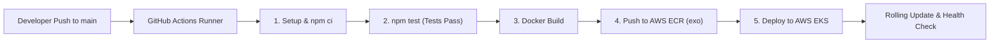
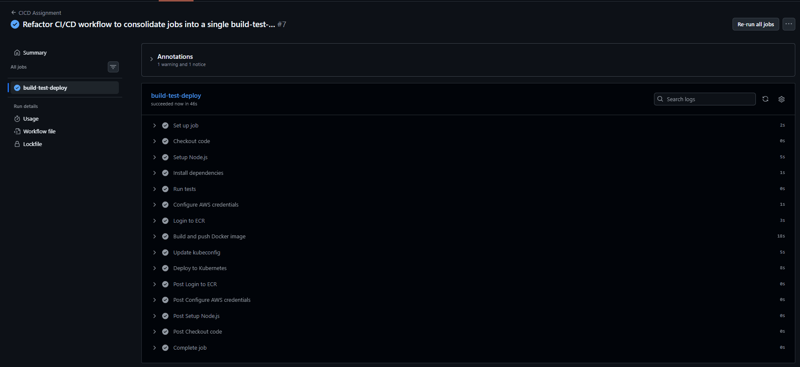

# Assignment 1: CI/CD Pipeline Automation (GitHub Actions -> ECR -> EKS)

## 📌 Overview
This assignment demonstrates an automated, end-to-end continuous integration and continuous deployment (CI/CD) pipeline for a containerized Node.js application. Every code push to the `main` branch triggers an automated GitHub Actions workflow that executes automated tests, builds and tags a Docker image, pushes it to Amazon Elastic Container Registry (ECR), and performs a rolling update to an Amazon Elastic Kubernetes Service (EKS) cluster.

---

## ⚙️ Environment & AWS Configuration
* **AWS Profile:** `exo`
* **AWS Account ID:** `713554441658`
* **AWS Region:** `ap-south-1` (Mumbai)
* **ECR Repository:** `raihan/app` (`713554441658.dkr.ecr.ap-south-1.amazonaws.com/raihan/app`)
* **Kubernetes Deployment:** `node-app`

---

## 🏗️ Architecture & Pipeline Flow



---

## 📁 Repository Structure
```text
CICD/
├── cicd.png                        # Successful GitHub Actions CI/CD pipeline run verification
├── app.js                          # Node.js Express application (/ and /health endpoints)
├── Dockerfile                      # Multi-stage lightweight Node Alpine container build
├── package.json                    # Project dependencies and automated test scripts
├── package-lock.json               # Deterministic dependency lock file
└── k8s/
    ├── deployment.yaml             # Kubernetes Deployment manifest for node-app
    └── Reference Image/
        └── image.png               # Verified deployment screenshot on EKS cluster
```

Workflow configuration:
```text
.github/
└── workflows/
    └── deploy.yaml                 # GitHub Actions CI/CD pipeline definition
```

---

## 🚀 Pipeline Stages Breakdown

The pipeline is defined in [`.github/workflows/deploy.yaml`](../.github/workflows/deploy.yaml):

### 1. Code Checkout & Node.js Setup
* Pulls repository code using `actions/checkout@v4`.
* Sets up Node.js v20 runtime using `actions/setup-node@v4`.

### 2. Dependency Installation & Automated Testing
* **Install:** Runs `npm ci` inside the `./CICD` directory to guarantee exact dependency versions.
* **Test:** Runs `npm test` inside `./CICD`. The test script in [`package.json`](./package.json) prints `testing completed` and returns exit code 0 to validate test execution before proceeding:
  ```json
  "scripts": {
    "start": "node app.js",
    "test": "echo \"testing completed\""
  }
  ```

### 3. AWS Authentication & ECR Login
* Uses `aws-actions/configure-aws-credentials@v4` with GitHub Secrets (`AWS_ACCESS_KEY_ID`, `AWS_SECRET_ACCESS_KEY`) using the **`exo`** profile credentials.
* Authenticates Docker CLI with AWS ECR registry using `aws-actions/amazon-ecr-login@v2`.

### 4. Container Build & Push
* Packages the Node.js application into a lightweight Docker image using [`Dockerfile`](./Dockerfile):
  ```dockerfile
  FROM node:22-alpine
  WORKDIR /app
  COPY . .
  RUN npm ci
  EXPOSE 3000
  CMD ["npm", "start"]
  ```
* Tags the container with the unique Git commit SHA (`${{ github.sha }}`) to ensure traceability and rollback capabilities:
  ```bash
  IMAGE_URI="$REGISTRY/$REPOSITORY:${{ github.sha }}"
  docker build -t "$IMAGE_URI" ./CICD
  docker push "$IMAGE_URI"
  ```

### 5. Kubernetes Deployment & Rollout Verification
* Configures `kubectl` context to connect to the target EKS cluster:
  ```bash
  aws eks update-kubeconfig --name ${{ secrets.EKS_CLUSTER_NAME }} --region ap-south-1
  ```
* Executes a zero-downtime rolling update on the `node-app` deployment with the freshly pushed image:
  ```bash
  kubectl set image deployment/node-app node-app="$IMAGE_URI"
  kubectl rollout status deployment/node-app
  ```

---

## 📷 Verification & Proof of Deployment

### 1. GitHub Actions CI/CD Pipeline Execution (`build-test-deploy`)
The screenshot below confirms the automated workflow succeeding end-to-end: running tests, configuring AWS credentials, authenticating with ECR, building and pushing the Docker container image, updating EKS kubeconfig, and rolling out the deployment:



---

### 2. Kubernetes Deployment Configuration & Active Pod
The screenshot below confirms the Kubernetes pod successfully running the container image pulled directly from AWS ECR repository `713554441658.dkr.ecr.ap-south-1.amazonaws.com/raihan/app`:


---

## 🧪 Local Testing & Verification
To test the pipeline steps locally:

```bash
# 1. Navigate to directory
cd CICD

# 2. Install dependencies
npm ci

# 3. Execute automated test script
npm test
# Output: "testing completed"

# 4. Build Docker container locally
docker build -t raihan/app:local .

# 5. Run container
docker run -p 3000:3000 raihan/app:local

# 6. Verify health endpoint
curl http://localhost:3000/health
# Output: OK
```
