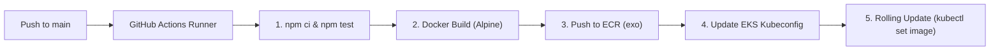
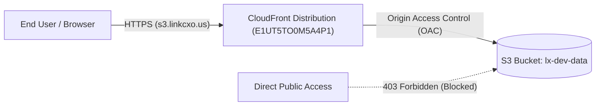
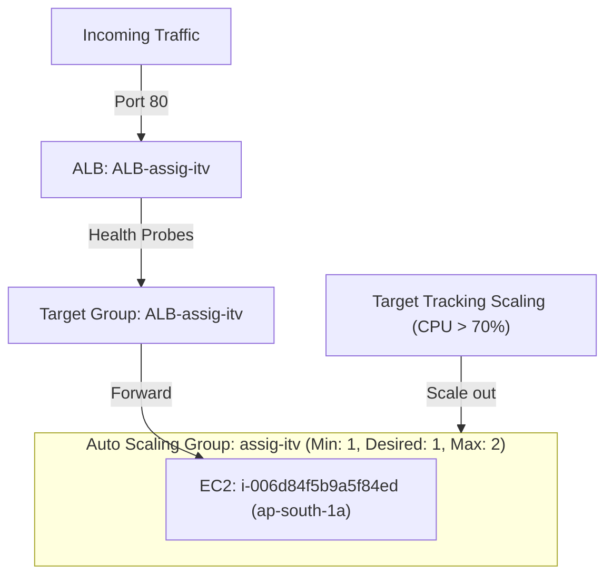

# DevOps Practical Assessment - IT Vedant

Comprehensive documentation and implementation artifacts for the three DevOps assessment tracks: **CI/CD Pipeline Automation**, **CloudFront with Secure S3 Origin**, and **High-Availability Auto Scaling Group with Application Load Balancer**.

---

## 📑 Quick Navigation & Assignment Index

| # | Assignment Track | AWS Profile | AWS Account ID | Key AWS Services | Folder / Documentation Link |
|---|---|---|---|---|---|
| **1** | [**CI/CD Pipeline**](#1-cicd-pipeline-github-actions--ecr--eks) | `exo` | `713554441658` | GitHub Actions, Docker, ECR, EKS, Kubernetes | [`CICD/`](./CICD/) &bull; [`CICD/README.md`](./CICD/README.md) |
| **2** | [**S3 + CloudFront CDN**](#2-cloudfront-cdn--secure-s3-static-origin) | `lxof` | `667528811503` | CloudFront, S3, IAM, ACM, VPC Endpoints | [`S3+Cloudfront/`](./S3+Cloudfront/) &bull; [`S3+Cloudfront/README.md`](./S3+Cloudfront/README.md) |
| **3** | [**ASG + ALB Architecture**](#3-auto-scaling-group-asg--application-load-balancer-alb) | `lxof` | `667528811503` | EC2, Launch Template, ASG, ALB, Target Groups | [`ASG+ALB/`](./ASG+ALB/) &bull; [`ASG+ALB/README.md`](./ASG+ALB/README.md) |

---

## 🔑 AWS Profiles Summary

As configured across environments:
* **`exo` profile (AWS Account ID: `713554441658`, Region: `ap-south-1`):** Used for **CI/CD** (ECR registry `713554441658.dkr.ecr.ap-south-1.amazonaws.com` and target Amazon EKS cluster).
* **`lxof` profile (AWS Account ID: `667528811503`, Region: `ap-south-1`):** Used for **S3 + CloudFront** (S3 bucket `lx-dev-data`, CloudFront distribution `E1UT5TO0M5A4P1`) and **ASG + ALB** (Launch Template `ly-lt`, Auto Scaling Group `assig-itv`, Load Balancer `ALB-assig-itv`).

---

## 1. CI/CD Pipeline (GitHub Actions -> ECR -> EKS)

* **Documentation:** [`CICD/README.md`](./CICD/README.md)
* **Workflow Source:** [`.github/workflows/deploy.yaml`](./.github/workflows/deploy.yaml)
* **Application Code:** [`CICD/app.js`](./CICD/app.js)
* **Kubernetes Manifest:** [`CICD/k8s/deployment.yaml`](./CICD/k8s/deployment.yaml)
* **AWS Profile:** `exo` (`713554441658`)

### Overview
Automated CI/CD pipeline triggered on every push to the `main` branch. The pipeline executes automated tests, packages the Node.js application into a Docker container, pushes the container to Amazon ECR, and deploys it with zero downtime to an Amazon EKS cluster.



### Pipeline Steps:
1. **Automated Testing:** Runs `npm test` inside `./CICD`, printing `testing completed` and exiting with code 0 to validate test assertions prior to building.
2. **Containerization:** Builds container using Alpine Linux via [`CICD/Dockerfile`](./CICD/Dockerfile).
3. **ECR Push:** Tags image with the Git commit SHA and pushes to repository `713554441658.dkr.ecr.ap-south-1.amazonaws.com/raihan/app:${{ github.sha }}`.
4. **EKS Rolling Update:** Connects to the EKS cluster, runs `kubectl set image deployment/node-app node-app="$IMAGE_URI"`, and waits for successful rollout using `kubectl rollout status`.

### Verified Deployment Reference:
The image below shows the running Kubernetes pod with the image deployed from ECR:


---

## 2. CloudFront CDN & Secure S3 Static Origin

* **Documentation:** [`S3+Cloudfront/README.md`](./S3+Cloudfront/README.md)
* **Bucket Policy:** [`S3+Cloudfront/s3_policy.json`](./S3+Cloudfront/s3_policy.json)
* **AWS Profile:** `lxof` (`667528811503`)

### Overview
A secure static website / content delivery setup where **Amazon CloudFront** serves as the CDN edge in front of an **Amazon S3** bucket (`lx-dev-data`). Direct public S3 access is strictly forbidden, and cache invalidation is configured for rapid asset updates.



### Key Configuration Highlights:
* **CloudFront Distribution ID:** `E1UT5TO0M5A4P1`
* **Distribution Domain:** `d2evn9szkajs7w.cloudfront.net`
* **Custom CNAME:** `s3.linkcxo.us` (Custom ACM SSL Certificate with TLSv1.2)
* **S3 Bucket:** `lx-dev-data`
* **Access Control & Restriction:**
  * Direct public S3 access is blocked via the bucket policy in [`S3+Cloudfront/s3_policy.json`](./S3+Cloudfront/s3_policy.json).
  * Only CloudFront's service principal (`cloudfront.amazonaws.com`) matching `AWS:SourceArn` of `arn:aws:cloudfront::667528811503:distribution/E1UT5TO0M5A4P1` is permitted to read objects.
  * Insecure transport is explicitly denied (`aws:SecureTransport: "false"`).
  * Direct access from outside authorized VPC `vpc-0f1e27305e6e935ff` is denied.
* **Cache Invalidation:**
  ```bash
  aws cloudfront create-invalidation --profile lxof --distribution-id E1UT5TO0M5A4P1 --paths "/*"
  ```

### CloudFront Console Configuration:


---

## 3. Auto Scaling Group (ASG) & Application Load Balancer (ALB)

* **Documentation:** [`ASG+ALB/README.md`](./ASG+ALB/README.md)
* **AWS Profile:** `lxof` (`667528811503`, Region `ap-south-1`)

### Overview
A fault-tolerant and elastic architecture utilizing an **Application Load Balancer (ALB)** distributing traffic across a pool of EC2 instances managed by an **Auto Scaling Group (ASG)**. The architecture features automatic target tracking scaling when CPU utilization exceeds 70%, as well as automatic self-healing to replace unhealthy instances.



### Key Components:
1. **Launch Template (`ly-lt` / `lt-0b9e77bcd7e646c9b`):** Defines AMI `ami-03765515c80e0c765`, `t2.micro`, security group `sg-0a53f3167c4175d95`, and key pair `ASG-key`.
2. **Application Load Balancer (`ALB-assig-itv`):** Internet-facing ALB deployed across subnets in `ap-south-1a`, `ap-south-1b`, and `ap-south-1c`. DNS endpoint: `ALB-assig-itv-259337061.ap-south-1.elb.amazonaws.com`.
3. **Target Group (`ALB-assig-itv`):** Routes HTTP:80 traffic to healthy registered instances (`i-006d84f5b9a5f84ed`).
4. **Auto Scaling Group (`assig-itv`):** Capacity limits set to Min: 1, Desired: 1, Max: 2.
5. **Dynamic Scaling (CPU > 70%):** Target tracking scaling policy continuously monitors average CPU utilization via Amazon CloudWatch. If CPU crosses 70%, ASG automatically spins up additional capacity.
6. **Automatic Unhealthy Instance Replacement:** Integrated ELB health checks continuously test target response. When an instance is deemed unhealthy, ASG terminates it and provisions a fresh instance from the Launch Template.

### Architecture Screenshots:

#### 1. Application Load Balancer


#### 2. Target Group & Target Health


#### 3. Auto Scaling Group


#### 4. Dynamic Scaling Policy (Target Tracking: CPU 70%)


#### 5. Active EC2 Instance


---

## 🛠️ Verification & Assessment Checklist

| Requirement | Implementation Artifact | Status |
|---|---|---|
| **CI/CD: GitHub Actions pipeline with tests, Docker build, ECR push, K8s deploy** | [`.github/workflows/deploy.yaml`](./.github/workflows/deploy.yaml) &bull; [`CICD/package.json`](./CICD/package.json) | ✅ Verified |
| **CloudFront: S3 origin configuration** | [`S3+Cloudfront/image.png`](./S3+Cloudfront/image.png) | ✅ Verified |
| **CloudFront: Restrict direct S3 access** | [`S3+Cloudfront/s3_policy.json`](./S3+Cloudfront/s3_policy.json) | ✅ Verified |
| **CloudFront: Cache invalidation** | [`S3+Cloudfront/README.md`](./S3+Cloudfront/README.md#cache-invalidation-configuration) | ✅ Verified |
| **ASG + ALB: Launch Template, ASG, ALB, Target Group** | [`ASG+ALB/ALB.png`](./ASG+ALB/ALB.png) &bull; [`ASG+ALB/ASG.png`](./ASG+ALB/ASG.png) | ✅ Verified |
| **ASG + ALB: Scale when CPU exceeds 70%** | [`ASG+ALB/Dynamic-scale.png`](./ASG+ALB/Dynamic-scale.png) | ✅ Verified |
| **ASG + ALB: Automatic replacement of unhealthy instances** | [`ASG+ALB/README.md`](./ASG+ALB/README.md#6-automatic-replacement-of-unhealthy-instances-self-healing) | ✅ Verified |
