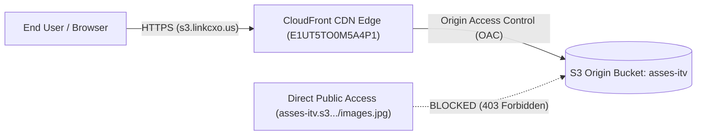
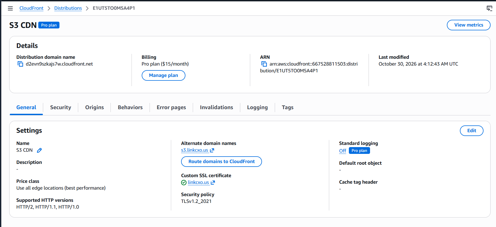

# Assignment 2: Amazon CloudFront with S3 Static Origin & Strict Access Controls

## 📌 Overview
This assignment demonstrates configuring **Amazon CloudFront** as a global Content Delivery Network (CDN) in front of an **Amazon S3** origin bucket (`asses-itv`). The architecture ensures low-latency content delivery worldwide, strictly restricts direct public access to S3, enforces HTTPS encryption, and provides cache invalidation capabilities for instant asset updates.

---

## ⚙️ Environment & AWS Configuration
* **AWS Profile:** `lxof`
* **AWS Account ID:** `667528811503`
* **AWS Region:** `ap-south-1` (Mumbai)
* **Origin S3 Bucket:** `asses-itv` (`https://asses-itv.s3.ap-south-1.amazonaws.com`)
* **CloudFront Distribution ID:** `E1UT5TO0M5A4P1`
* **CloudFront Distribution Domain:** `d2evn9szkajs7w.cloudfront.net`
* **Custom CNAME / Alternate Domain:** `s3.linkcxo.us`
* **SSL/TLS Security Policy:** `TLSv1.2_2021` (Custom ACM certificate for `linkcxo.us`)
* **Price Class:** Use all edge locations (best performance)

---

## 🏗️ Architecture & Security Model



---

## 📁 Repository Structure
```text
S3+Cloudfront/
├── image.png             # AWS CloudFront distribution console configuration screenshot
├── s3_policy.json        # Production-grade S3 bucket policy enforcing Origin Access Control (OAC)
└── README.md             # Assignment documentation and runbook
```

---

## 🛡️ Restricting Direct S3 Access (Origin Access Control)

To prevent users from bypassing the CloudFront CDN edge and accessing S3 directly, the S3 bucket `asses-itv` disables public access and attaches an AWS Origin Access Control (OAC) policy. The policy is located in [`s3_policy.json`](./s3_policy.json).

### OAC Bucket Policy Statement:
Only requests originating from the authorized CloudFront distribution ARN (`arn:aws:cloudfront::667528811503:distribution/E1UT5TO0M5A4P1`) using the CloudFront service principal (`cloudfront.amazonaws.com`) are permitted to read objects:

```json
{
    "Version": "2012-10-17",
    "Statement": [
        {
            "Sid": "AllowCloudFrontServicePrincipal",
            "Effect": "Allow",
            "Principal": {
                "Service": "cloudfront.amazonaws.com"
            },
            "Action": "s3:GetObject",
            "Resource": "arn:aws:s3:::asses-itv/*",
            "Condition": {
                "StringEquals": {
                    "AWS:SourceArn": "arn:aws:cloudfront::667528811503:distribution/E1UT5TO0M5A4P1"
                }
            }
        }
    ]
}
```

---

## 🧪 Endpoint Verification & Access Control Tests

Testing an asset stored in the bucket (`images.jpg`) demonstrates that direct access to the S3 bucket endpoint is rejected, while access through both CloudFront domain endpoints succeeds:

### 1. Direct S3 Origin URL (Blocked - 403 Forbidden)
Direct public requests to the S3 origin are denied by Amazon S3:
```bash
curl -I https://asses-itv.s3.ap-south-1.amazonaws.com/images.jpg
```
**Response:**
```http
HTTP/1.1 403 Forbidden
Server: AmazonS3
x-amz-error-code: AccessDenied
Date: Fri, 30 Oct 2026 07:38:07 GMT
```

### 2. Custom Domain via CloudFront (Allowed - 200 OK)
Requests routed through the custom domain `s3.linkcxo.us` are authenticated via OAC and served from the CloudFront edge:
```bash
curl -I https://s3.linkcxo.us/images.jpg
```
**Response:**
```http
HTTP/1.1 200 OK
Content-Type: image/jpeg
Content-Length: 35575
Connection: keep-alive
Server: AmazonS3
X-Cache: Miss from cloudfront (or Hit from cloudfront)
Via: 1.1 925da6731bc24b2ab4b14e088855fb5a.cloudfront.net (CloudFront)
```

### 3. CloudFront Distribution Default Domain (Allowed - 200 OK)
Requests routed through the default CloudFront distribution domain `d2evn9szkajs7w.cloudfront.net` are likewise served successfully:
```bash
curl -I https://d2evn9szkajs7w.cloudfront.net/images.jpg
```
**Response:**
```http
HTTP/1.1 200 OK
Content-Type: image/jpeg
Content-Length: 35575
Connection: keep-alive
Server: AmazonS3
X-Cache: Miss from cloudfront (or Hit from cloudfront)
Via: 1.1 25b0581f55c9bc23ece1b989f01118bc.cloudfront.net (CloudFront)
```

---

## ⚡ Cache Invalidation Configuration

When static assets are updated or replaced in S3, CloudFront edge caches must be invalidated so that users immediately receive the freshest version rather than cached copies.

### 1. Invalidation via AWS CLI
Using the `lxof` AWS profile:

```bash
# Invalidate all cached objects across edge caches
aws cloudfront create-invalidation \
  --profile lxof \
  --distribution-id E1UT5TO0M5A4P1 \
  --paths "/*"

# Invalidate a specific updated file
aws cloudfront create-invalidation \
  --profile lxof \
  --distribution-id E1UT5TO0M5A4P1 \
  --paths "/images.jpg"
```

### 2. Invalidation via AWS Management Console
1. Navigate to **CloudFront** > **Distributions** > `E1UT5TO0M5A4P1`.
2. Select the **Invalidations** tab.
3. Click **Create invalidation**.
4. Enter the object path (e.g., `/*` or `/images.jpg`) and click **Create invalidation**.
5. The status transitions from `InProgress` to `Completed`.

---

## 📷 Verification & Proof of Configuration

The screenshot below displays the active CloudFront CDN distribution settings with alternate domain name `s3.linkcxo.us`, distribution ARN, and origin details:


