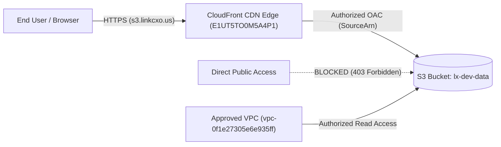

# Assignment 2: Amazon CloudFront with S3 Static Origin & Strict Access Controls

## 📌 Overview
This assignment demonstrates configuring **Amazon CloudFront** as a global Content Delivery Network (CDN) in front of an **Amazon S3** bucket origin. The architecture ensures low-latency content delivery worldwide, strictly restricts direct public access to S3, enforces end-to-end HTTPS encryption, and provides cache invalidation capabilities for instant asset updates.

---

## ⚙️ Environment & AWS Configuration
* **AWS Profile:** `lxof`
* **AWS Account ID:** `667528811503`
* **Origin S3 Bucket:** `lx-dev-data`
* **CloudFront Distribution ID:** `E1UT5TO0M5A4P1`
* **CloudFront Distribution Domain:** `d2evn9szkajs7w.cloudfront.net`
* **Custom CNAME / Alternate Domain:** `s3.linkcxo.us`
* **SSL/TLS Security Policy:** `TLSv1.2_2021` (Custom ACM certificate for `linkcxo.us`)
* **Price Class:** Use all edge locations (best performance)

---

## 🏗️ Architecture & Security Model



---

## 📁 Repository Structure
```text
S3+Cloudfront/
├── image.png             # AWS CloudFront distribution console configuration screenshot
├── s3_policy.json        # Production-grade S3 bucket policy enforcing access controls
└── README.md             # Assignment documentation and runbook
```

---

## 🛡️ Restricting Direct S3 Access (Bucket Policy Analysis)

To prevent users from bypassing the CloudFront distribution and accessing S3 directly, a strict S3 bucket policy is attached to `arn:aws:s3:::lx-dev-data`. The complete policy is available in [`s3_policy.json`](./s3_policy.json).

### Key Policy Statements:

1. **CloudFront Service Principal Authorization (`AllowCloudFrontServicePrincipal`):**
   Allows the CloudFront service principal (`cloudfront.amazonaws.com`) to read objects from the bucket only when originating from the specific distribution ARN:
   ```json
   {
     "Sid": "AllowCloudFrontServicePrincipal",
     "Effect": "Allow",
     "Principal": {
       "Service": "cloudfront.amazonaws.com"
     },
     "Action": "s3:GetObject",
     "Resource": "arn:aws:s3:::lx-dev-data/*",
     "Condition": {
       "StringEquals": {
         "AWS:SourceArn": "arn:aws:cloudfront::667528811503:distribution/E1UT5TO0M5A4P1"
       }
     }
   }
   ```

2. **Denying Insecure Transport / HTTP (`DenyInsecureTransport`):**
   Rejects any communication that does not use SSL/TLS (`aws:SecureTransport: false`), guaranteeing encryption in transit:
   ```json
   {
     "Sid": "DenyInsecureTransport",
     "Effect": "Deny",
     "Principal": "*",
     "Action": "s3:*",
     "Resource": [
       "arn:aws:s3:::lx-dev-data",
       "arn:aws:s3:::lx-dev-data/*"
     ],
     "Condition": {
       "Bool": {
         "aws:SecureTransport": "false"
       }
     }
   }
   ```

3. **Denying Unapproved Principals Outside VPC & CloudFront (`DenyUnapprovedPrincipalsOutsideVPC`):**
   Blocks any traffic coming from outside the authorized VPC (`vpc-0f1e27305e6e935ff`) unless it originates from the authorized CloudFront distribution or approved administrator IAM identities (`Raihan`, `s3-user`):
   ```json
   {
     "Sid": "DenyUnapprovedPrincipalsOutsideVPC",
     "Effect": "Deny",
     "Principal": "*",
     "Action": "s3:*",
     "Resource": [
       "arn:aws:s3:::lx-dev-data",
       "arn:aws:s3:::lx-dev-data/*"
     ],
     "Condition": {
       "StringNotEquals": {
         "aws:SourceVpc": "vpc-0f1e27305e6e935ff"
       },
       "ArnNotEquals": {
         "aws:SourceArn": "arn:aws:cloudfront::667528811503:distribution/E1UT5TO0M5A4P1"
       },
       "ArnNotLike": {
         "aws:PrincipalArn": [
           "arn:aws:iam::667528811503:user/Raihan",
           "arn:aws:iam::667528811503:user/s3-user",
           "arn:aws:iam::713554441658:role/S3CrossAccountReplicationRole"
         ]
       }
     }
   }
   ```

4. **VPC Endpoint Access & Cross-Account Replication:**
   Allows internal applications residing in `vpc-0f1e27305e6e935ff` to read data, while granting cross-account replication read permissions to `arn:aws:iam::713554441658:role/S3CrossAccountReplicationRole`.

---

## ⚡ Cache Invalidation Configuration

When static website assets (such as HTML, CSS, JavaScript, or images) are updated in S3, CloudFront edge caches must be invalidated so users immediately receive the updated version.

### 1. Invalidation via AWS CLI
Using the `lxof` AWS profile:

```bash
# Invalidate all cached objects across edge caches
aws cloudfront create-invalidation \
  --profile lxof \
  --distribution-id E1UT5TO0M5A4P1 \
  --paths "/*"

# Invalidate specific updated files or directory paths
aws cloudfront create-invalidation \
  --profile lxof \
  --distribution-id E1UT5TO0M5A4P1 \
  --paths "/index.html" "/styles/*"
```

### 2. Invalidation via AWS Management Console
1. Navigate to **CloudFront** > **Distributions** > `E1UT5TO0M5A4P1`.
2. Select the **Invalidations** tab.
3. Click **Create invalidation**.
4. Enter the object path (e.g., `/*` or `/index.html`) and click **Create invalidation**.
5. The status transitions from `InProgress` to `Completed`.

---

## 📷 Verification & Proof of Configuration

The screenshot below displays the active CloudFront CDN distribution settings with alternate domain name `s3.linkcxo.us`, distribution ARN, and origin details:


